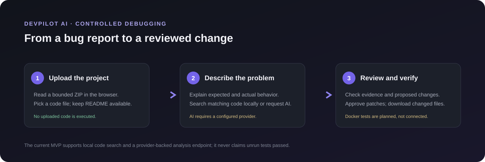
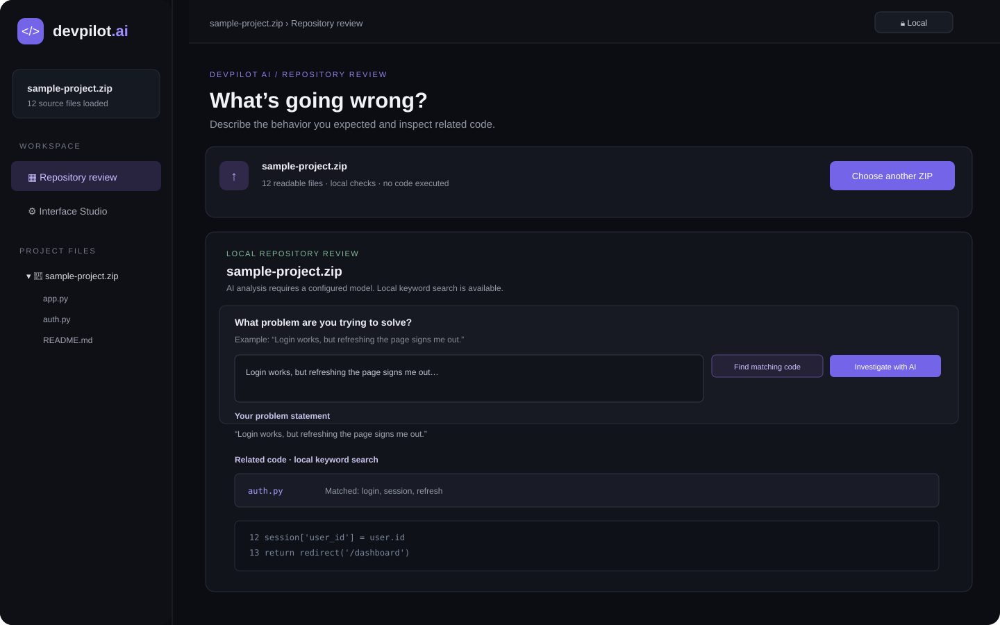
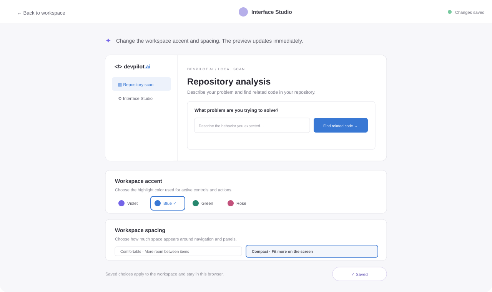

# DevPilot AI

DevPilot AI is a browser based software debugging workspace. The goal is to help a developer explain a bug in plain language, locate relevant repository code, review a suggested fix, and understand how to verify it. This repository contains the current working MVP, its FastAPI service, a sample project archive, the supplied design reference PDF, and the illustrations used in this guide.

> **Current status:** repository upload, local search, code editing, simple checks, file download, and Interface Studio work in the frontend. AI investigation needs a running FastAPI backend and an OpenAI compatible provider key. Test execution, GitHub integration, database indexing, and Tree-sitter are planned and are not implemented yet.

## What the product is for

When a developer encounters a failure, they should be able to:

1. Open a project archive and understand which files DevPilot can read.
2. Describe what they expected and what actually happened.
3. Find code that may relate to that description, or ask a configured model to investigate repository excerpts.
4. Review the evidence, explanation, and exact proposed code diff.
5. Choose whether to apply a suggestion, edit the code, revert it, and download the changed file.
6. See which tests a model recommends. The MVP does not run those tests.

The product direction includes evidence backed root cause explanations, explainable code changes, regression prevention, a controlled repair loop, and repository memory. The current app is a first usable slice toward that larger product; those future capabilities are labeled in the roadmap below.

## How the current workflow works



1. **Start a project:** upload a `.zip` archive or choose **Try included sample**.
2. **Explain the problem:** write the observed behavior and the expected behavior in the problem box. The text remains visible with the local search results.
3. **Find related code:** **Find matching code** searches readable source text for words from the description. This is local keyword matching, not a semantic diagnosis.
4. **Investigate with AI (optional):** when the FastAPI service and model provider are configured, the app sends the problem and a bounded set of repository excerpts to the provider. The response can include a summary, root cause, file evidence, patch suggestions, test suggestions, confidence, and limitations.
5. **Review and change:** select evidence to open its file, inspect the before/after patch, and apply only a patch whose original text still matches. You can edit in the Monaco editor, save into the current browser session, or revert to the uploaded content.
6. **Keep your edit:** download the selected file. Changes are not written back into the uploaded ZIP.

## Pictures and interface

The images below are **illustrative UI previews** created for this README. They explain the intended screens and are not captured screenshots of the running app.

### Repository review and code editor



This screen is where a developer loads a project, writes the problem statement, reviews local search or AI evidence, selects source files, and edits code.

### Interface Studio



Interface Studio previews workspace style changes. In the current app, accent color and comfortable/compact spacing update the preview immediately and can be saved in browser storage.

## What works today

| Area | Current behavior |
| --- | --- |
| Project intake | Upload ZIP in the browser or open the included sample repository. |
| Problem statement | Enter and retain a plain language description while reviewing matches. |
| Local code search | Search supported source text for terms from the problem statement and open matching files. |
| AI investigation | Optional provider backed analysis through FastAPI, when configured. |
| Evidence and patches | Display model summary, evidence, exact patch text, and suggested tests; verify patch context before applying. |
| Editor | Monaco editor with editable source, save to session, revert, and selected file download. |
| Code checks | Simple pattern checks for Python `eval`/`exec`, bare `except`, and likely hard coded credentials. |
| Interface Studio | Live preview, four accent colors, comfortable/compact density, and saved style preferences. |
| Preferences | Theme and editor font size settings saved in local browser storage. |
| Backend API | FastAPI health, archive intake, and model analysis endpoints. |

The checks are deliberately simple signals. They can miss problems or flag harmless text; they are not a complete parser, test suite, or security audit.

## Technology choices and implementation status

| Layer | Choice | Status in this project |
| --- | --- | --- |
| Frontend | React + TypeScript + Vite | Implemented |
| Styling | Tailwind CSS + project CSS | Tailwind is configured; workspace styling is primarily project CSS |
| Code editor | Monaco Editor | Implemented |
| Backend | Python + FastAPI | Implemented for health, archive intake, and analysis routes |
| AI engine | LLM API + agent orchestration | A single provider-backed analysis request is implemented; multi-step orchestration and autonomous retries are not |
| Code parsing | Tree-sitter | Planned; current frontend checks use text patterns |
| Database | PostgreSQL | Planned; current MVP keeps project state in browser memory |
| Vector search | pgvector | Planned |
| Execution | Docker | Planned; no uploaded code is executed |
| Version control | Git + GitHub API | Git is used for development; user repository integration is planned |
| Testing | Pytest + Vitest | Test frameworks and automated regression tests are not wired into this MVP |

## Run the website locally

### Requirements

- Node.js 18 or newer and npm.
- Python 3.10 or newer for the optional API service.
- An OpenAI compatible provider account and API key only if you want to use AI investigation. Provider usage may incur charges.

### 1. Start the frontend

From the project directory:

```bash
npm install
npm run dev
```

Open the local address printed by Vite, usually `http://localhost:5173`.

### 2. Start the optional FastAPI backend

Open a second terminal in the project directory:

```bash
cd backend
python -m venv .venv
```

Activate the environment and install the API dependencies:

```powershell
# Windows PowerShell
.\.venv\Scripts\Activate.ps1
pip install -r requirements.txt
```

```bash
# macOS / Linux
source .venv/bin/activate
pip install -r requirements.txt
```

Set provider settings in that terminal, then start the server on port 8000.

```powershell
# Windows PowerShell
$env:DEVPILOT_LLM_API_KEY = "your-provider-key"
$env:DEVPILOT_LLM_MODEL = "gpt-4.1-mini"
$env:DEVPILOT_LLM_BASE_URL = "https://api.openai.com/v1"
uvicorn app.main:app --reload --port 8000
```

```bash
# macOS / Linux
export DEVPILOT_LLM_API_KEY="your-provider-key"
export DEVPILOT_LLM_MODEL="gpt-4.1-mini"
export DEVPILOT_LLM_BASE_URL="https://api.openai.com/v1"
uvicorn app.main:app --reload --port 8000
```

Vite proxies `/api` requests to `http://127.0.0.1:8000`. If the service is not running, local project search and editing remain available, while AI investigation reports that the service is offline.

### Provider environment settings

| Variable | Purpose | Default / requirement |
| --- | --- | --- |
| `DEVPILOT_LLM_API_KEY` | Secret sent by the backend to authenticate to the model provider | Required for provider-backed analysis; never put it in frontend code |
| `DEVPILOT_LLM_MODEL` | Provider model name | `gpt-4.1-mini` |
| `DEVPILOT_LLM_BASE_URL` | OpenAI compatible API root | `https://api.openai.com/v1` |

The API key belongs only in the backend process environment. Do not commit it to source control or paste it into browser settings. When a user selects **Investigate with AI**, the problem statement and selected repository excerpts are sent to the configured provider. Do not send code you are not authorized to share.

## API routes

| Method | Route | Purpose |
| --- | --- | --- |
| `GET` | `/api/health` | Reports whether the API is reachable and whether a provider key is configured. |
| `POST` | `/api/repositories/upload` | Accepts a ZIP using multipart field `file` and validates archive limits. |
| `POST` | `/api/debug/analyze` | Sends supplied problem text and source excerpts to the configured model and returns structured analysis. |

The current frontend reads ZIP contents in the browser. Its local workflow does not upload or execute the archive on the backend. The model analysis request sends text excerpts only when the user explicitly starts AI investigation.

## Safety, privacy, and current limits

- ZIP uploads are limited to **25 MiB**; uncompressed source content is limited to **100 MiB**. The frontend reads at most 5,000 archive entries and source files up to 1 MiB each.
- Common Python, JavaScript, TypeScript, Java, C/C++, JSON, YAML, TOML, and text/Markdown extensions are supported. Other files may be skipped.
- Local archive review happens in browser memory. Uploaded code is not extracted to disk or executed by this MVP.
- AI context is bounded to at most 100 files and about 280,000 characters from the browser request. The backend applies its own request bounds.
- Applying a patch updates the current in-memory file only. Download the changed file to keep it; the original ZIP is not rewritten.
- Tests shown in an AI report are suggestions only. There is no test runner or isolated Docker sandbox yet.
- PostgreSQL, pgvector, GitHub authentication/API, Tree-sitter, persistent repository memory, multi-step agent planning, automatic regression test creation, and autonomous repair retries are not connected.
- Keep secrets out of uploaded source files. The simple credential pattern check is not a substitute for a secret scanner.

## Roadmap

| Phase | Work | Status |
| --- | --- | --- |
| 1 | Workspace UI, project intake, problem statement, preferences | MVP available |
| 2 | Repository indexing and structural code understanding | Basic in-browser text indexing; Tree-sitter and persistent index planned |
| 3 | AI debugging and root-cause evidence | Provider backed first analysis available when configured; deeper call/dependency graph planned |
| 4 | Explainable patch generation and diff review | Basic suggested patch review and apply available |
| 5 | Regression prevention and controlled repair loop | Planned; tests are not run or generated automatically |
| 6 | Docker test isolation and resource controls | Planned; do not execute untrusted code on the API host |
| 7 | GitHub integration, security auditing, and repository memory | Planned |

## BharatCode Build League submission notes

This section records the event information supplied in the project brief. Confirm the current rules and form fields on the official submission site before submitting; the event details below are not independently verified here.

### Suggested registration details

- **Category:** Coding & Developer Tools.
- **Project name:** `DevPilot AI – Autonomous Software Engineering Agent` (within the stated 2–160 character limit).
- **Main repository:** submit the URL of the public GitHub repository after publishing this project. The URL has not been supplied yet.
- **Short summary (under 1,000 characters):**

  > DevPilot AI is a developer workspace for understanding repository code and investigating software problems. Upload a project ZIP, describe the behavior you expected, find related source files with local search, and review evidence and suggested code changes from an optional configured AI model. Edit and download changed files, inspect simple code checks, and tailor the workspace in Interface Studio. The current MVP uses React, TypeScript, Monaco Editor, and FastAPI. Test execution, GitHub integration, and persistent repository indexing are planned and are not yet implemented.

### Event information included in the supplied brief

- **Submission deadline stated:** 10 November 2026, 11:59 PM IST.
- **Awards stated:** ₹10,000 first prize; 1,000 free Adaption credits per participant; US$1,000 Adaption credits per winning team member; three Ginhouse event tickets; and consideration for an official BharatCode offering.
- **Submission items stated:** project name, public GitHub repository URL, and an optional summary (maximum 1,000 characters). The supplied information did not list a PDF upload as mandatory.
- **Repository file called out:** `BharatCode.txt` in the repository root. This project includes that file as a concise project and submission note; verify whether the organizers prescribe exact file contents or formatting.

### Model provider requirement

The brief says BharatCode powers model calls and recommends integrating its model API. **This repository does not currently contain a BharatCode-specific API integration.** The optional backend currently uses an OpenAI-compatible API root configured with `DEVPILOT_LLM_BASE_URL`, `DEVPILOT_LLM_API_KEY`, and `DEVPILOT_LLM_MODEL`. Do not describe BharatCode integration as complete until the official API details are confirmed, the backend is updated, and an end-to-end request succeeds.

### Submission readiness checklist

- [ ] Confirm the official category, requirements, deadline, and prize details.
- [ ] Integrate and verify the BharatCode model API if required by the organizers.
- [ ] Publish the project in a public GitHub repository.
- [ ] Keep `BharatCode.txt` in the repository root.
- [ ] Paste the public repository URL and project name into the submission form.
- [ ] Use the summary above or revise it to match the final working features.
- [ ] Submit before the stated deadline.

## Project layout

```text
devpilot-ai/
├── backend/
│   ├── app/main.py             # FastAPI routes and provider-backed analysis
│   ├── requirements.txt        # Python API dependencies
│   └── Dockerfile              # Backend container build definition (not a code runner)
├── docs/images/                # README workflow and interface illustrations
├── BharatCode.txt              # Hackathon project and submission note
├── public/sample-repository.zip # Small archive for trying the intake flow
├── references/design-reference.pdf # Supplied reference PDF, included unchanged
├── src/
│   ├── App.tsx                 # Workspace, local scan, editor, Interface Studio
│   ├── main.tsx                # React entry point
│   ├── style.css               # Workspace and editor styles
│   └── feedback.css            # Interface Studio and feedback styles
├── index.html
├── package.json
└── README.md
```

## Build the frontend

```bash
npm run build
```

This runs the TypeScript build and creates the static frontend in `dist/`. The optional API is started separately with Uvicorn as described above.

## Design reference

The provided PDF is preserved in [`references/design-reference.pdf`](references/design-reference.pdf). The SVG illustrations in `docs/images/` are original documentation visuals for explaining the workflow and screens.
